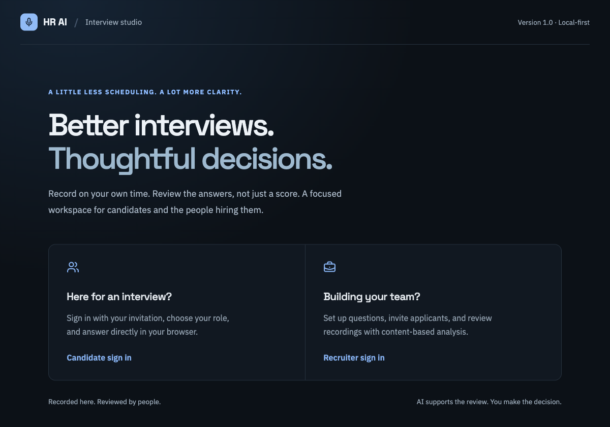
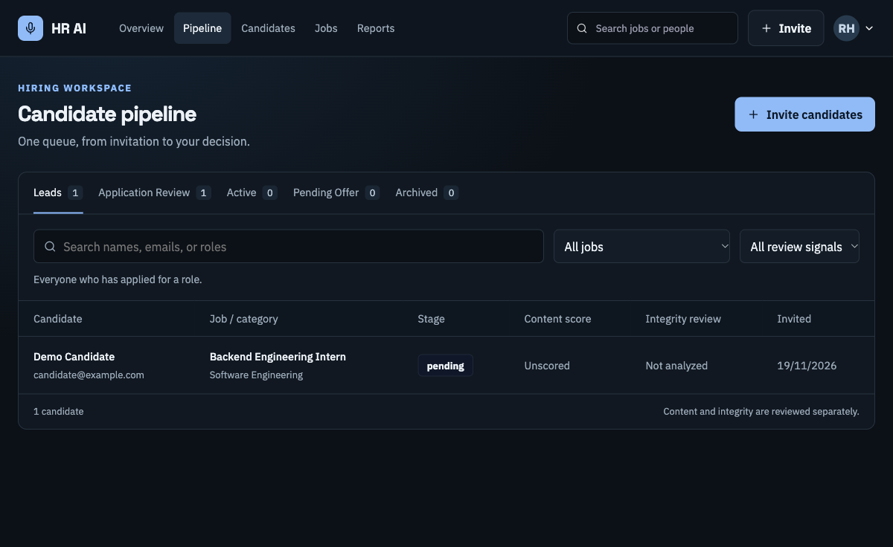

# HR AI Interview Platform

**Version 1.0 | Local-first, asynchronous interview and review workspace**

Candidates record answers in the browser. Recruiters review recordings, transcripts, question-level feedback, and separate proctoring signals. Administrators provision recruiter accounts. AI supports a human decision; it does not make one.



Built with **React + TypeScript, FastAPI, PostgreSQL, Redis, ffmpeg, and Docker Compose**. A lightweight worker runs the ETL pipeline by default; Apache Airflow is an optional alternative.

## Quick Start

Requires Git and Docker Desktop with Compose v2. Use a desktop Chrome/Edge browser for recording. Windows users can run the launcher in WSL or Git Bash. Allow several minutes for the first image download/build.

```sh
git clone https://github.com/lmaosyed/hr-ai-interview-platform.git
cd hr-ai-interview-platform
bash scripts/start.sh
```

The launcher creates `.env` only if missing, generates a persistent session secret, builds the services, and waits for startup. It does not reset existing accounts or recordings.

| Service | Local URL |
| --- | --- |
| Main app | http://localhost:55173 |
| Administrator | http://localhost:55173/admin/login |
| Recruiter | http://localhost:55173/hr/login |
| Candidate | http://localhost:55173/candidate-login |
| Independent practice session | http://localhost:55173/hrai/practisesession |
| Interactive API docs | http://localhost:58000/docs |
| Captured invitation emails | http://localhost:58025 |

New installations create **only `admin / admin`**. Configure `BOOTSTRAP_ADMIN_USERNAME` and `BOOTSTRAP_ADMIN_PASSWORD` in `.env` before the first run to change these. Recruiter and candidate accounts are created through the application; there are no hidden sample scores or prefilled logins. Services bind to localhost, not the public network.

**Reviewing this project for an interview?** Follow the [10-minute reviewer walkthrough](docs/REVIEWER_GUIDE.md). See [architecture and scoring](docs/ARCHITECTURE.md), [reference projects](docs/REFERENCES.md), and [verification notes](docs/REVIEW_NOTES.md).

## What Works



Screenshots use manually created reviewer records with no personal data. They are not seeded into your installation.

| Area | Implemented |
| --- | --- |
| Admin | Provision HR logins; search HR/candidate directories; suspend accounts; inspect service setup |
| Recruiter | Job/category library; spoken, text and code questions; per-question timers and optional rubric; single/bulk invitations with expiry; candidate search; notes; shortlist/reject; job analytics |
| Candidate | Profile and resume; multiple role invitations; overview/consent; webcam, mic and entire-screen recording; fullscreen; 30-second preparation; completed-interview tracking; deadline-extension requests |
| Review | Video playback, searchable question transcripts, approximate timestamp highlights, score rationale, separate integrity events, failed-analysis retry |
| Engineering | Validated API inputs; ownership checks; raw/processed storage; Redis ingestion queue; tracked pipeline runs; worker recovery of pending uploads |

Practice has its own route, capture artifacts, and reports. It uses the same recorder and scoring services, but **does not create candidate applications or hiring records**. It is deliberately absent from the main landing page and HR navigation. The former `/evaluation-lab` URL redirects to the independent route.

## Optional Real AI

**No API key is needed to explore administration, jobs, invitations, profiles, or recording uploads. Meaningful transcription and answer scoring require a valid provider key and available quota.** Missing/invalid credentials produce an explicit failure, never invented transcripts or plausible-looking sample scores. Silent answers receive zero credit through deterministic guards.

For Gemini, edit only your ignored local `.env`:

```dotenv
DEMO_MODE=false
LLM_PROVIDER=gemini
TRANSCRIPTION_PROVIDER=gemini
GEMINI_API_KEY=your_own_key
GEMINI_MODEL=gemini-2.5-flash
```

Get a key from [Google AI Studio](https://aistudio.google.com/apikey). Free-tier eligibility, model availability, and limits vary by account/region; free quota is not guaranteed. OpenAI transcription and Anthropic scoring are optional alternatives, not requirements. Never put keys in frontend code, commits, screenshots, or chat.

After changing configuration:

```sh
docker compose up -d --force-recreate fastapi worker
```

Admin's **Check AI connection** checks access to the configured model. It is not an accuracy benchmark or a guarantee of generation quota. `DEMO_MODE=true` does not enable fake evaluations.

## Data Flow

```text
Candidate browser                         Separate practice route
  camera + mic + entire-screen recorder    same capture/scoring services
                 |                                  |
              FastAPI ----------------------- isolated lab artifacts
                 |
    storage/raw/{session_id} + PostgreSQL session
                 |
           Redis queue -> Python worker (or Airflow)
                 |
     ffmpeg -> answer-window transcription -> rubric scoring
                 |
    storage/processed/{session_id} + PostgreSQL review facts
                 |
         HR recording / answers / integrity / notes
```

Raw recordings are the source layer; processed JSON is the analytics layer. The pipeline performs **ETL**: ingest recordings, transform audio and answer segments, then load question/session facts. Redis decouples ingestion from processing; pipeline-run records provide observability. The database is a normalized operational schema, not a full dimensional warehouse. Details and formulas are in [ARCHITECTURE.md](docs/ARCHITECTURE.md).

## Useful Commands

```sh
docker compose ps                              # service status
docker compose logs --tail=80 fastapi worker    # processing errors
docker compose exec react npm run build        # TypeScript + production build
docker compose exec react npm audit            # dependency advisory check
docker compose exec fastapi python -m compileall -q backend
docker compose stop                            # stop without deleting data
```

If a port is occupied, change `FRONTEND_PORT`, `API_PORT`, `MAILBOX_PORT`, `POSTGRES_PUBLIC_PORT`, `REDIS_PUBLIC_PORT`, or `SMTP_PUBLIC_PORT` in `.env`. The UI uses a same-origin API proxy, so no frontend API URL edit is needed. Use the URL printed by the launcher. `docker compose down` retains named volumes; **`down -v` deletes the database**, so do not use it for a normal restart.

For host-only frontend development, run `npm ci` and `npm run dev` in `frontend` while Docker's backend runs. Vite proxies to `http://localhost:58000`; `API_PROXY_TARGET` can override this. No host Python/Node installation is required for the normal Docker path.

### Optional Airflow

First generate a Fernet key and place it in `AIRFLOW__CORE__FERNET_KEY`. Then:

```sh
docker compose stop worker
docker compose --profile airflow up -d --build
```

Airflow UI: http://localhost:8080 (`admin / admin` for this local prototype). Do not run Airflow and the default worker against the same queue. The default Docker walkthrough is the supported, verified path; Airflow is an optional teaching integration.

## Honest Boundaries

This is a **college/portfolio MVP, not a production hiring service**. See [SECURITY.md](SECURITY.md) before exposing it beyond localhost.

- AI models and score heuristics are not validated hiring assessments. Content scores do not establish employability; delivery is not a psychological confidence measurement.
- Camera landmarks provide an approximate attention signal, not calibrated eye tracking or proof of cheating. Screen corners, glasses, and lighting can affect results. Proctoring stays separate from the overall score.
- Question windows and browser events have captured times; sentence/highlight timestamps are approximate and labeled as such.
- Code is reviewed as text, not executed in a secure code runner. Offers/hiring are not managed; "Pending Offer" currently means shortlisted for another round.
- Mailpit captures emails locally. Real inbox delivery needs your SMTP service; localhost invite links work only on the same machine.
- Recordings upload in one multipart request. Resumable/chunked uploads, retention automation, production auth, and schema migrations remain future work.
- Browser permission/fullscreen restrictions cannot be bypassed. Share an **entire screen**, not a window/tab; a second click may be required for fullscreen. Candidate refresh intentionally ends the in-memory login.

The original [v1.0.0 release](https://github.com/lmaosyed/hr-ai-interview-platform/releases/tag/v1.0.0) is preserved. `main` contains the reviewer-readiness improvements. No credentials, resumes, recordings, automated test suites, or generated lab reports are included.
